# UI/UX review: changes and screenshots

Code: commit bd86096 on `development`. Before screenshots were taken on 2026-11-11 from a local copy with seeded test data; after screenshots show the built change.

**Summary:** 49 files, about +1,200 / −9,600 lines. `InterviewManagement.tsx` 6,476 → ~1,680 lines, `JDMatch.tsx` 2,107 → ~1,080. Interview Dashboard, Client Feedback and the candidate-details pop-up removed (old links redirect).

## Phase 1 · Quick fixes

### 1. Interviews API needs a login

Before: `GET /api/v1/interviews` with no login returned every interview (candidate names, emails, meeting links), because a request without a token was treated as the first user in the database. After: **401 Unauthorized**. The same now applies to settings (SMTP, AI config), mail templates, resume templates and transcription, which had no check at all. Client and interviewer accounts only see their own interviews.

| Before | After |
| --- | --- |
|  |  |

### 2. Client Feedback mock page removed

It showed a hard-coded candidate and "Submit" saved nothing. Removed from the sidebar and routes; `/client-feedback` redirects to Interviews.

| Before | After |
| --- | --- |
|  |  |

### 3. Interview filters and buttons

Clear Filters ignored the Recommendation filter (rows stayed hidden with no way to clear), and selecting rows showed two Bulk Feedback buttons. Now Clear Filters shows a count and covers every filter; one bulk button; the fake "Save draft" is gone; Name/Email boxes folded into the main search.

| Before | After |
| --- | --- |
|   |   |

### 4. Search sends 1 request instead of 21

Each keystroke refetched interviews, all users and all interview types. Search is now debounced (300 ms) and users/types load once. Typing "Lakshmi": **21 requests → 1** (measured).

### 5. Dashboard header

Search box, bell and gear did nothing; every user had the same stock photo. Search now opens Candidates filtered by the text; dead buttons removed; initials avatar.

| Before | After |
| --- | --- |
|  |  |

## Phase 2 · One interview flow

### 6. One short interview form

Six forms (Schedule, Edit, Reschedule, Next Round, Interview Dashboard, JD Match) became one `InterviewForm` with about 10 fields. Salary, joining date and outcome moved to the feedback step. The panel's availability shows inline; scheduling a candidate who already has an open interview now says why instead of silently doing nothing.

| Before | After |
| --- | --- |
|  |   |

### 7. One Interviews screen with a Today view

Interview Dashboard and Interviews showed the same data twice. Interviews now opens on **Today and Upcoming** (plus "Needs feedback"); **All** is the table. `/interview-dashboard` redirects.

| Before | After |
| --- | --- |
|   |  |

### 8. Row menu fits the interview's state

Every row offered the same 8 actions, even a no-show from last week. The same row now offers 3.

| Before | After |
| --- | --- |
|  |  |

### 9. One feedback panel

The feedback panel now serves one interview or many (the separate ~1,000-line single modal is gone). A verdict you pick is never overwritten by later rating changes; offer fields appear only after Selected; bulk feedback now records who gave it.

| Before | After |
| --- | --- |
|  |  |

## Phase 3 · Data model

### 10. Stage and Verdict instead of one 14-value Recommendation

**Verdict** (Pending, Selected, Rejected, On Hold, No Show) and **Stage** (Screening, Interviewing, Offer, Hired, Closed) are computed from the existing `recommendation` on read. No stored data is rewritten. Filters on the Interviews table.

| Before | After |
| --- | --- |
|  |  |

### 11. Candidate list shows the hiring stage

Stage column and filter chips; parse status shown only when parsing failed. Profile route is now `/candidates/:id` (old links redirect).

| Before | After |
| --- | --- |
|  |  |

### 12. Analytics and Dashboard from real data

Counts read resume statuses nothing ever sets (always 0), the trend line was generated from totals, the success ring was hard-coded at 70%, and five donut charts drew nothing. All now come from interview data, with a working date range.

| Before | After |
| --- | --- |
|  |   |

## Phase 4 · Polish

### 13. In-app messages instead of browser popups

All `alert()` / `confirm()` calls replaced by a shared toast and confirm dialog.

| Before | After |
| --- | --- |
| _No visual before (see text)_ |  |

### 14. Sidebar down to 7 items

Dashboard, Upload, Candidates, JD Match, Interviews, Analytics, Settings. Resume templates open from Candidates; interview types live in Settings.

| Before | After |
| --- | --- |
|  |  |

### 15. Phone layout

Bottom navigation bar and interview cards instead of a side rail and a 1,150 px table.

| Before | After |
| --- | --- |
|  |  |

## Restored after review (PR #60)

An audit of the old screens against the new ones found fields and features that were no longer reachable. [PR #60](https://github.com/shine25-ai/Ai_resumeparser/pull/60) restores all of them, so **nothing captured or offered before is missing**. The main interview form still shows the essentials first.

### Fields restored
| Field | Where it is now |
| --- | --- |
| Meeting platform, interview location, HR call verification | Interview form → More details |
| Job location, job type | Interview form → More details |
| Candidate's requested date / time / role, salary requested | Interview form → More details (also in the feedback panel's offer section) |
| Documents attached when scheduling | Interview form → More details (upload) |
| Interview status (manual change) | Interview form → More details, in Edit mode |
| Final salary, joining date | Feedback panel → Offer details, openable any time (auto-opens after Selected) |

| More details (optional) | Offer details |
| --- | --- |
| 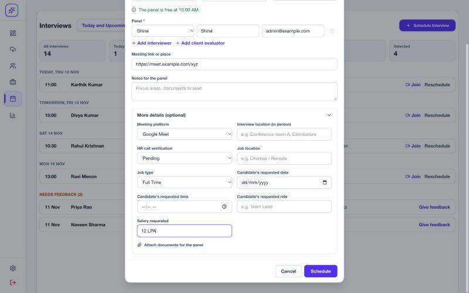 | 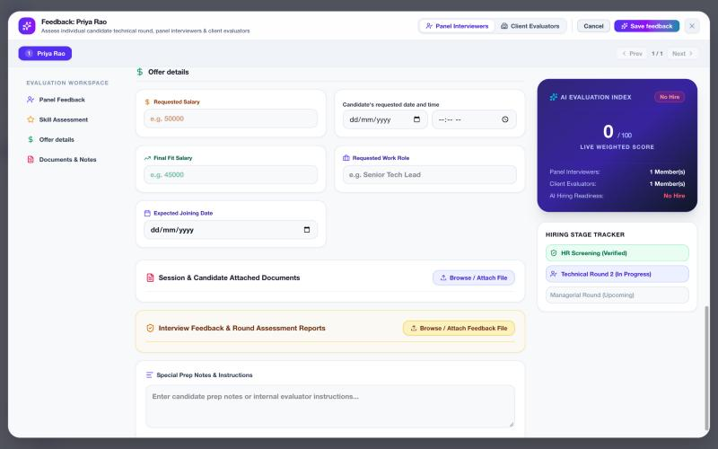 |

### Features restored
- **Interview history** pop-up (every round with all details), as a row action. Its resume button linked to a route that doesn't exist; it now opens the candidate profile.
- **Email interview summary** for selected interviews, with an Excel/CSV attachment (was on the old Interview Dashboard).
- **Summary counts** (old Interview Dashboard) on the Today and Upcoming view.
- **Sort by score** and filtering by the **exact old outcome values** on the All view.
- **Edit details** on finished and closed interviews.

| Interview history | Row actions |
| --- | --- |
| 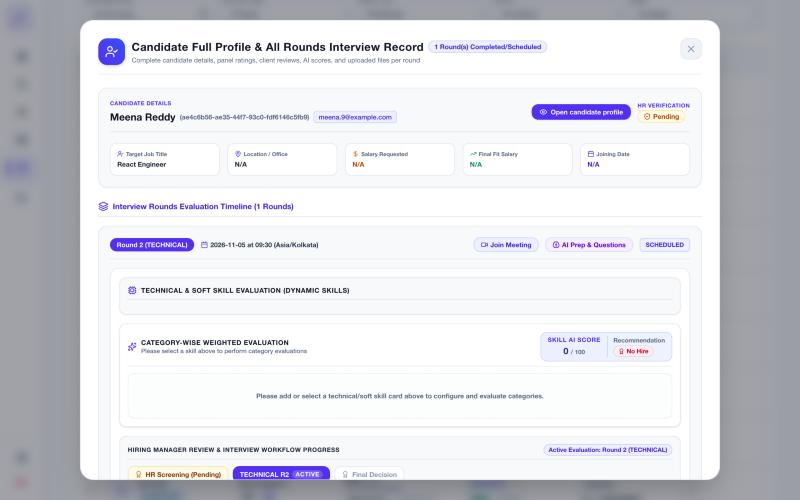 | 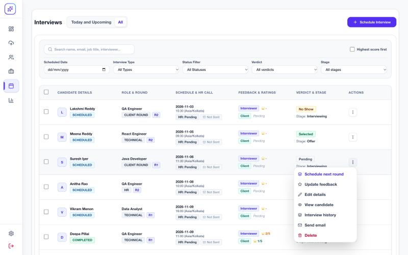 |

| Email interview summary | Summary counts |
| --- | --- |
| 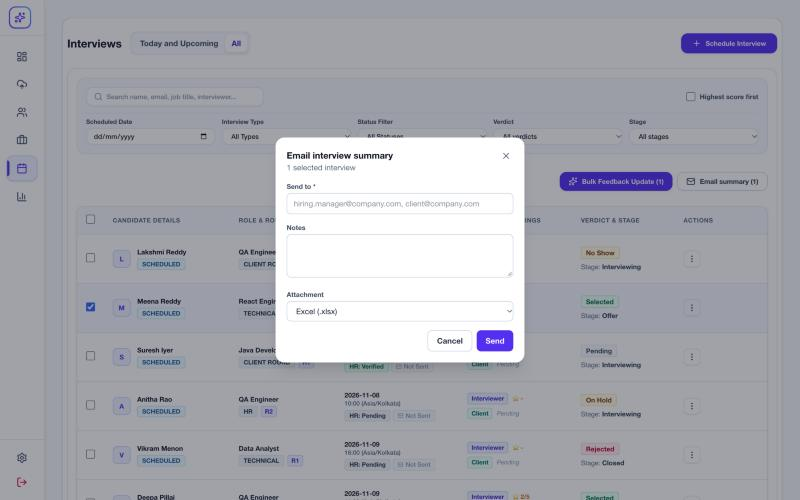 | 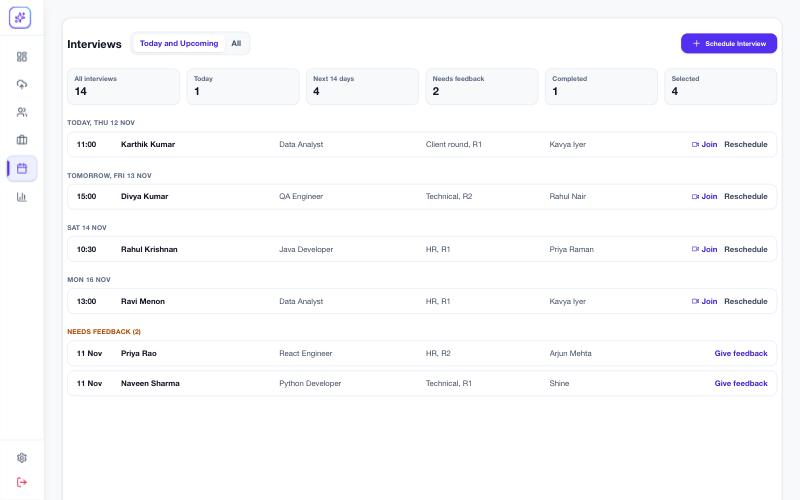 |

### Client feedback
The old Client Feedback page was a mock (hard-coded candidate; Save stored nothing), so no saved data was lost by removing it. Client feedback is entered in the feedback panel's **Client Evaluators** tab. A client user signs in, sees only their own interviews, and the panel opens on their own entry. Checked by signing in as a test client:
- **Fixed (older bug):** the panel showed "4" and "Selected" for evaluators not yet rated but saved them empty, and saving without a rating wrote a rating of 1. Empty now shows as "Not rated" / Pending, and only entered ratings are saved.
- Roles that had only the old **Client Feedback** permission now open the Interviews page instead of an empty app.

| Client user's view | Client feedback |
| --- | --- |
| 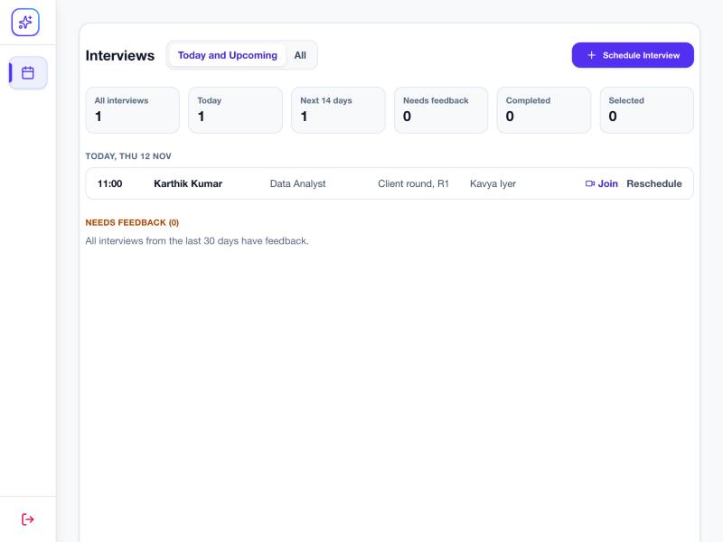 | 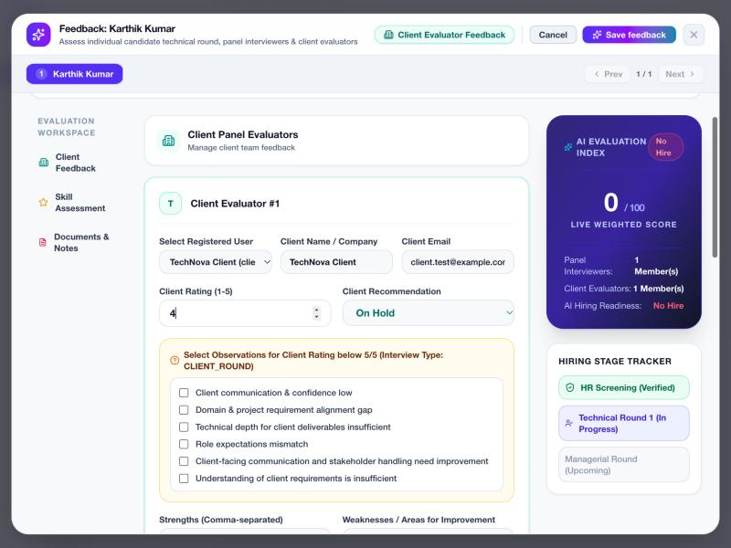 |

### Bugs fixed while restoring
- Editing an interview reset its type to the first configured type; it now keeps its own type.
- An interview earlier today couldn't get feedback until the next day; interviews scheduled today now offer **Give feedback**.

### Walkthrough video
[`docs/ux-review/walkthrough.mp4`](https://github.com/shine25-ai/Ai_resumeparser/blob/fix/restore-captured-fields/docs/ux-review/walkthrough.mp4): 2 min 26 s, 27 captioned steps (test data). It follows one candidate: find them, Round 1 with AI questions (saved with the round and back when reopened) and feedback, Round 2 with offer details, the full history, then client feedback, analytics and the phone layout.

## How the interview flow works

1. **Schedule.** **Schedule Interview** on the Interviews page, **Schedule** from a candidate, or several at once from JD Match. One short form: job, type, round, date, time, panel and link; everything else is under **More details**. Panel availability is checked as you type.
2. **Before the interview.** It shows under its day in **Today and Upcoming**, with **Join** and **Reschedule**. The row menu also has edit, history, email and cancel.
3. **After the start time.** It moves to **Needs feedback**, and **Give feedback** becomes the first action.
4. **Feedback.** One panel for one interview or many. Each panel member and client gets a rating, outcome and comments. Skill ratings and documents are optional, and offer details open after **Selected** (or by hand). Saving marks the interview **Completed**.
5. **Verdict and Stage** are worked out from the outcome when read: Verdict says how this round went (Pending, Selected, Rejected, On Hold, No Show); Stage says where the candidate is (Interviewing, Offer, Hired, Closed). Nothing stored is rewritten.
6. **Next round.** Once a round is done, **Schedule next round** is the first action (see below).
7. **Client.** A client user signs in, lands on Interviews, sees only their own interviews and gives feedback in the same panel.

## How rounds are managed

- **Each round is its own interview** with a `round_number`, linked to the candidate. Nothing is overwritten when a new round is added.
- **Round number is filled in.** The next round = the highest round of the **same interview type** + 1. A new type starts at 1 (Technical R1, Technical R2, then HR R1). It can be changed by hand.
- **One open round per candidate.** A new round can't be booked while the candidate has an interview that isn't Completed or Cancelled. Giving feedback completes it. The server enforces this for single and bulk scheduling.
- **Where rounds show up:**
  - The **All** list shows each candidate's latest round.
  - **Interview history** shows every round with all its details.
  - The feedback panel's **Interview rounds** box lists the candidate's real rounds, with the one being reviewed highlighted. It used to show the same three hard-coded steps for everyone.

| Row actions for a scheduled round | Schedule next round once feedback is in |
| --- | --- |
| 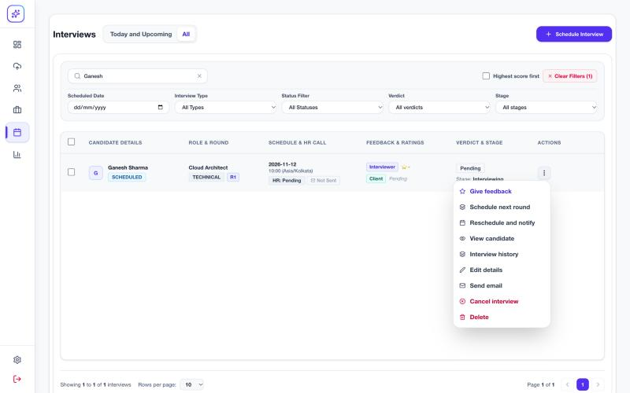 | 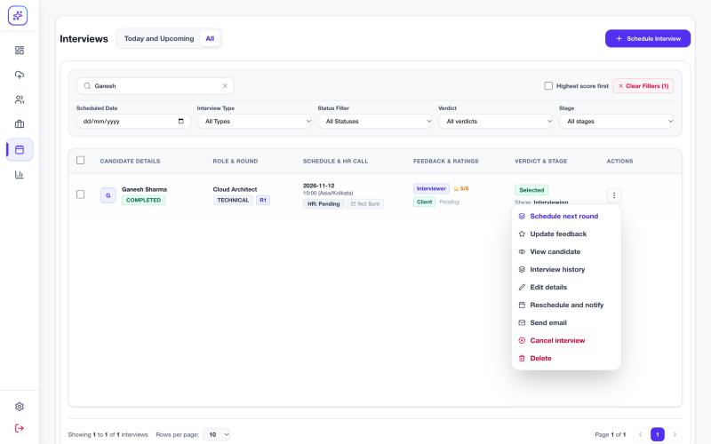 |
| **Round 2 filled in, panel checked** | **Feedback for Round 2 with the real rounds** |
| 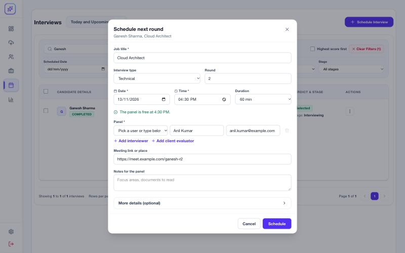 | 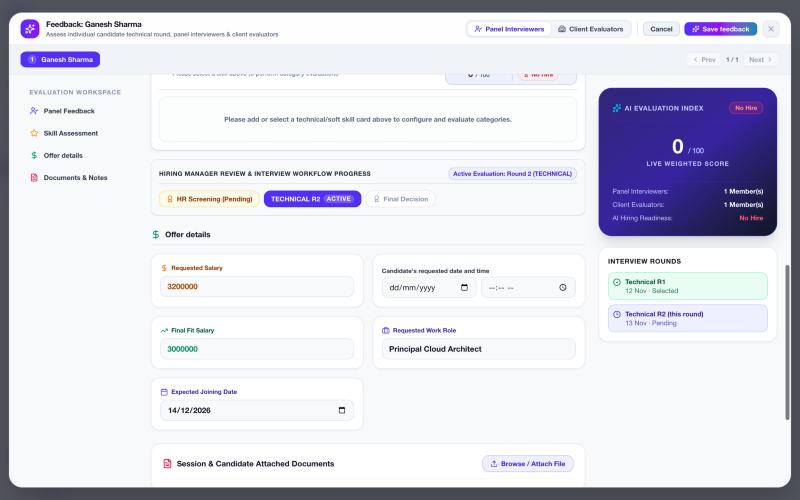 |

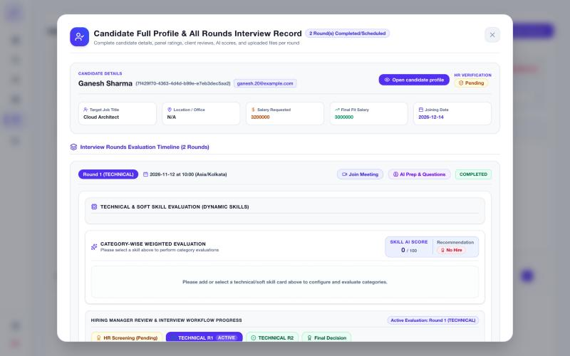

## Where the interview questions are

- **Where:** Interviews → row menu → **Interview history** → the round → **AI Prep & Questions**.
- **Generate questions:**
  - Asks the AI for technical, behavioral and domain questions from the candidate's resume and the round's skills, each with an expected answer and how to judge it.
  - **Generate more questions** adds new ones without repeats.
- **Video answer:** upload the candidate's recording; it is transcribed, then **Evaluate via video** scores the answer to each question.
- **How it runs:** browser → backend `POST /api/resumes/{id}/generate-questions` → ai-parser `/api/generate-questions` → the AI model set in Settings → AI. The ai-parser service and the model must be running.
- **Saved with the round** (PR #60): questions, the video transcript and the scores are stored on that round and come back when the panel is opened again. A full **Re-generate** replaces the questions and clears their scores. Before PR #60 they were lost when the panel closed.
- **On `development`:** the history pop-up that holds this panel was unreachable after the simplification. PR #60 brings it back.

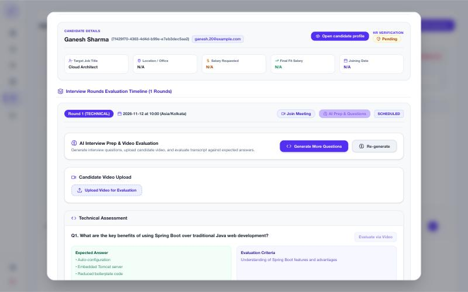

### Fixed in PR #60 while checking rounds and questions
- **Placeholder rows:** an empty "Client Evaluator 1" row was saved with every feedback and next round. Empty rows are no longer saved, and the history no longer shows a made-up client card.
- **Workflow strip:** the strip in the feedback panel marked Round 1 as active on every round. It now marks the round being reviewed.
- **Questions panel crash:** it crashed when the AI returned an expected answer as a list. It now accepts lists and objects.
- **Row menu:** every action stays reachable, and the menu is no longer cut off on short tables.

## Testing
- `tsc` clean; production build succeeds.
- Backend: 134 passed, including new `test_route_auth.py` and `test_hiring_stage.py`. The 1 failure + 5 errors also fail before these changes (test setup).
- Checked in the browser against a local database with seeded interviews. Not clicked through: the in-app delete confirmation and the transcription fix.

## Notes for reviewers
- Callers without a login token now get 401 on the routes above. Nothing in this repo calls them without one.
- Settings needs login but not admin; restricting writes to admins is a sensible follow-up.
- This landed on `development` without review; comments on this PR are the place to flag anything.
