# UI/UX review: changes and screenshots

Code: commit bd86096 on `development`. Before screenshots were taken on 2026-11-11 from a local copy with seeded test data; after screenshots show the built change.

**Summary:** 49 files, about +1,200 / −9,600 lines. `InterviewManagement.tsx` 6,476 → ~1,680 lines, `JDMatch.tsx` 2,107 → ~1,080. Interview Dashboard, Client Feedback and the candidate-details pop-up removed (old links redirect).

## Phase 1 · Quick fixes

### 1. Interviews API needs a login

Before: `GET /api/v1/interviews` with no login returned every interview (candidate names, emails, meeting links), because a request without a token was treated as the first user in the database. After: **401 Unauthorized**. The same now applies to settings (SMTP, AI config), mail templates, resume templates and transcription, which had no check at all. Client and interviewer accounts only see their own interviews.

| Before | After |
| --- | --- |
| 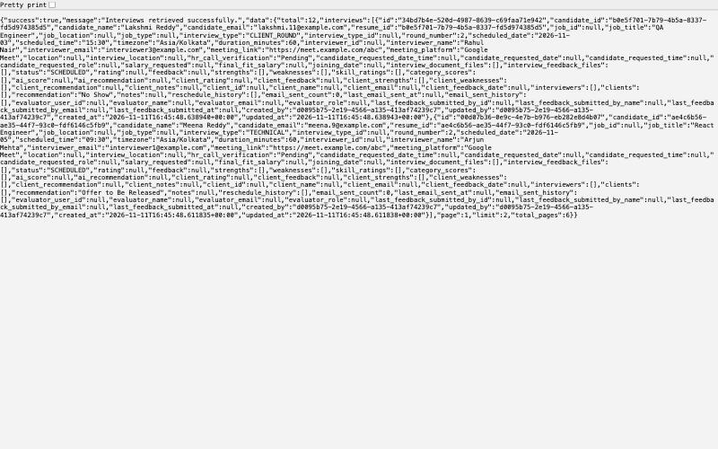 | 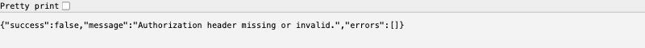 |

### 2. Client Feedback mock page removed

It showed a hard-coded candidate and "Submit" saved nothing. Removed from the sidebar and routes; `/client-feedback` redirects to Interviews.

| Before | After |
| --- | --- |
| 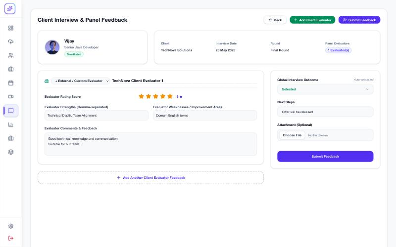 | 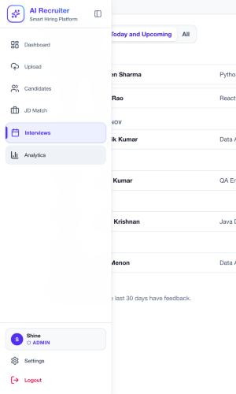 |

### 3. Interview filters and buttons

Clear Filters ignored the Recommendation filter (rows stayed hidden with no way to clear), and selecting rows showed two Bulk Feedback buttons. Now Clear Filters shows a count and covers every filter; one bulk button; the fake "Save draft" is gone; Name/Email boxes folded into the main search.

| Before | After |
| --- | --- |
| 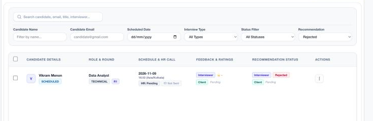 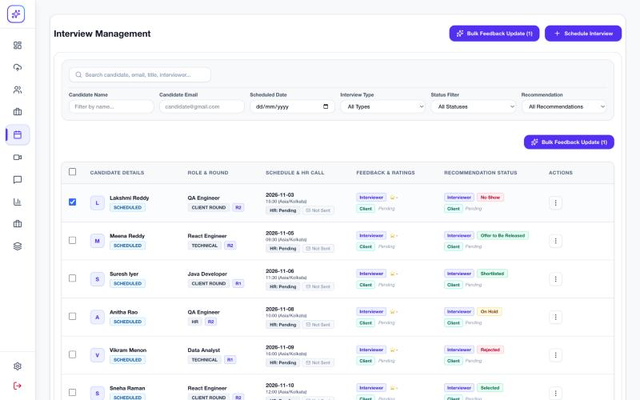 | 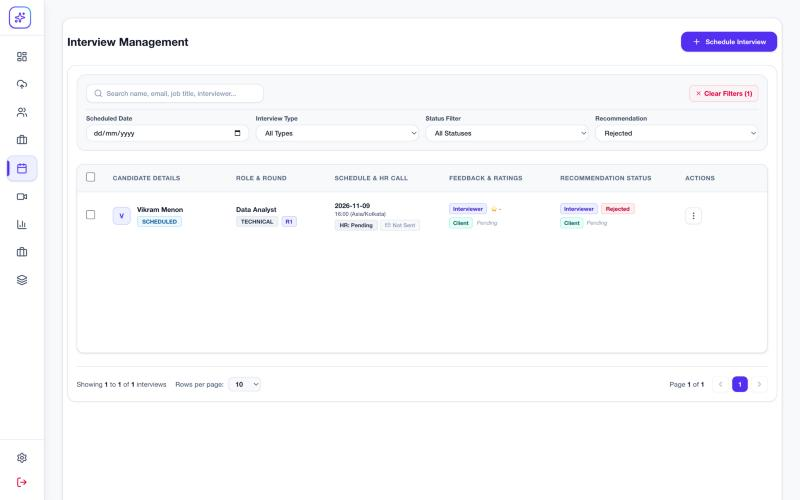 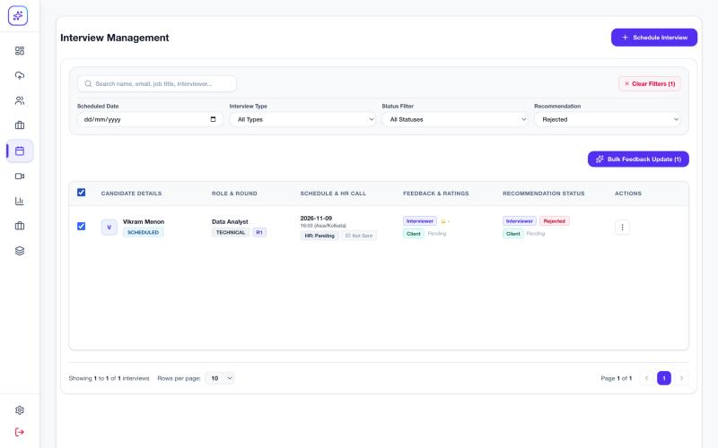 |

### 4. Search sends 1 request instead of 21

Each keystroke refetched interviews, all users and all interview types. Search is now debounced (300 ms) and users/types load once. Typing "Lakshmi": **21 requests → 1** (measured).

### 5. Dashboard header

Search box, bell and gear did nothing; every user had the same stock photo. Search now opens Candidates filtered by the text; dead buttons removed; initials avatar.

| Before | After |
| --- | --- |
| 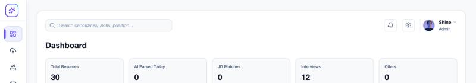 | 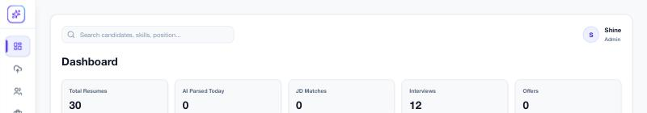 |

## Phase 2 · One interview flow

### 6. One short interview form

Six forms (Schedule, Edit, Reschedule, Next Round, Interview Dashboard, JD Match) became one `InterviewForm` with about 10 fields. Salary, joining date and outcome moved to the feedback step. The panel's availability shows inline; scheduling a candidate who already has an open interview now says why instead of silently doing nothing.

| Before | After |
| --- | --- |
| 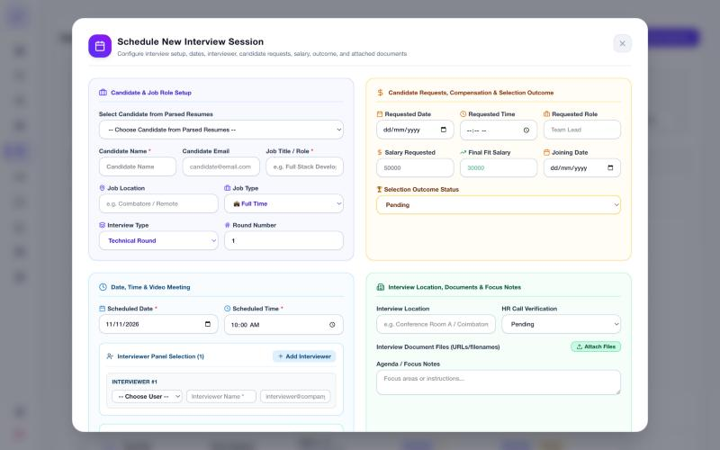 | 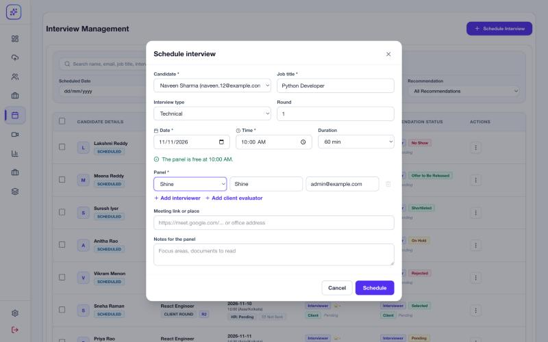 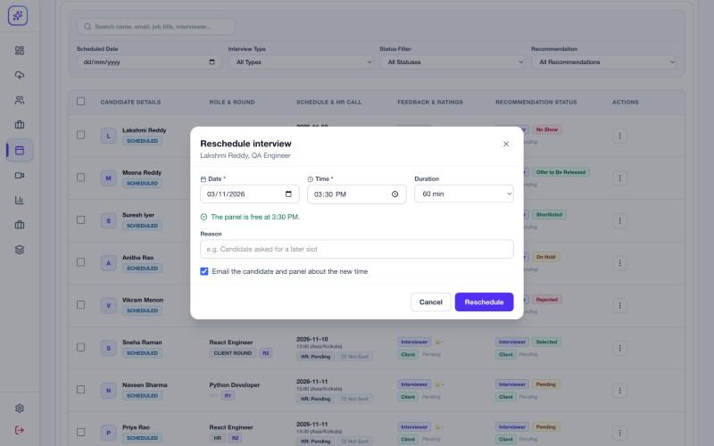 |

### 7. One Interviews screen with a Today view

Interview Dashboard and Interviews showed the same data twice. Interviews now opens on **Today and Upcoming** (plus "Needs feedback"); **All** is the table. `/interview-dashboard` redirects.

| Before | After |
| --- | --- |
| 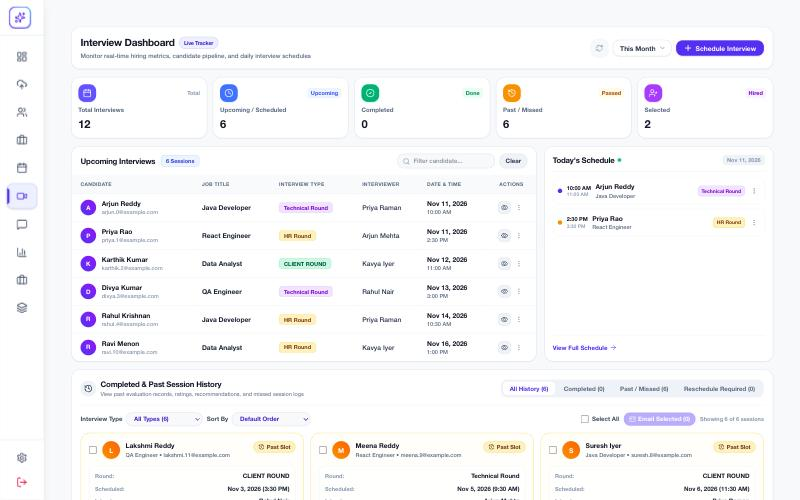 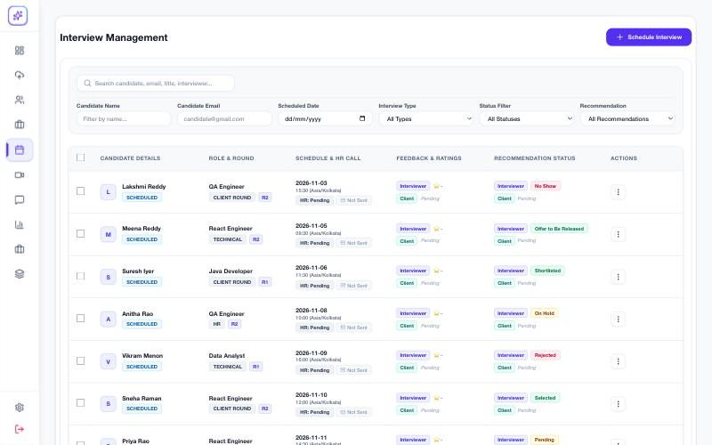 | 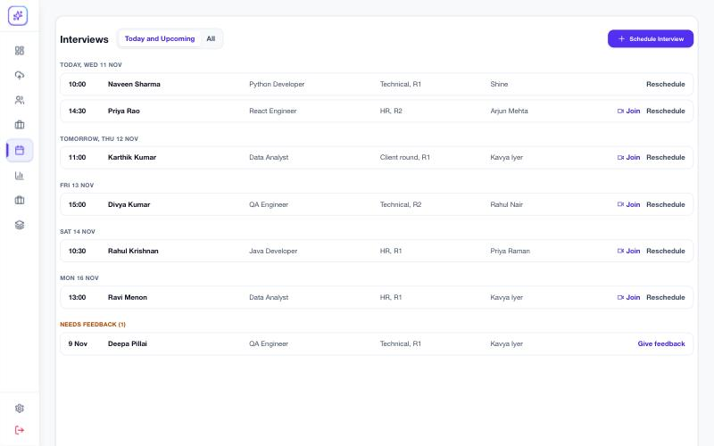 |

### 8. Row menu fits the interview's state

Every row offered the same 8 actions, even a no-show from last week. The same row now offers 3.

| Before | After |
| --- | --- |
| 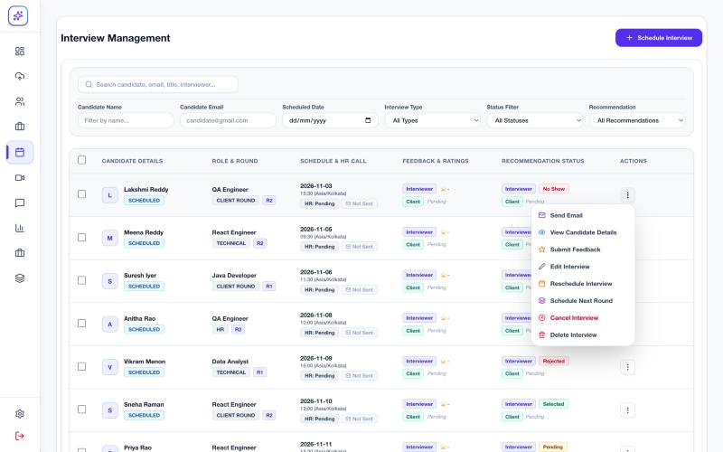 | 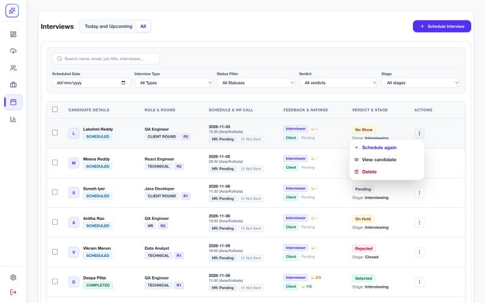 |

### 9. One feedback panel

The feedback panel now serves one interview or many (the separate ~1,000-line single modal is gone). A verdict you pick is never overwritten by later rating changes; offer fields appear only after Selected; bulk feedback now records who gave it.

| Before | After |
| --- | --- |
|  | 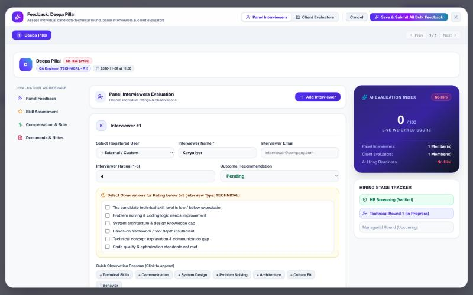 |

## Phase 3 · Data model

### 10. Stage and Verdict instead of one 14-value Recommendation

**Verdict** (Pending, Selected, Rejected, On Hold, No Show) and **Stage** (Screening, Interviewing, Offer, Hired, Closed) are computed from the existing `recommendation` on read. No stored data is rewritten. Filters on the Interviews table.

| Before | After |
| --- | --- |
|  | 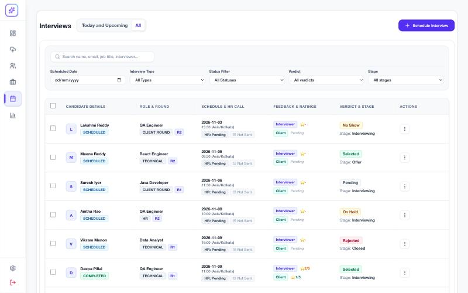 |

### 11. Candidate list shows the hiring stage

Stage column and filter chips; parse status shown only when parsing failed. Profile route is now `/candidates/:id` (old links redirect).

| Before | After |
| --- | --- |
| 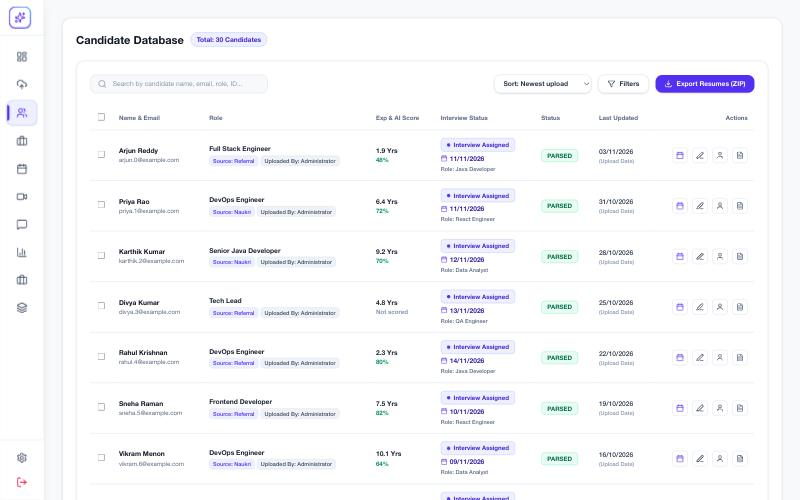 | 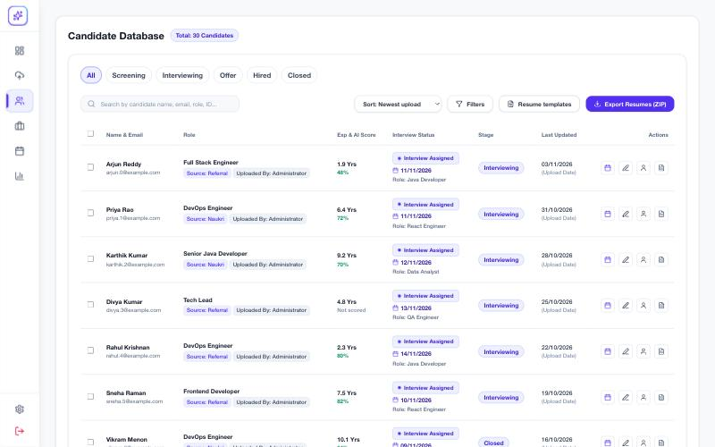 |

### 12. Analytics and Dashboard from real data

Counts read resume statuses nothing ever sets (always 0), the trend line was generated from totals, the success ring was hard-coded at 70%, and five donut charts drew nothing. All now come from interview data, with a working date range.

| Before | After |
| --- | --- |
| 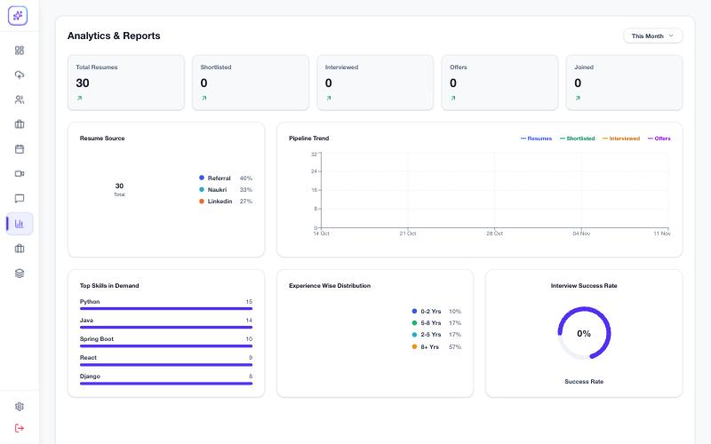 | 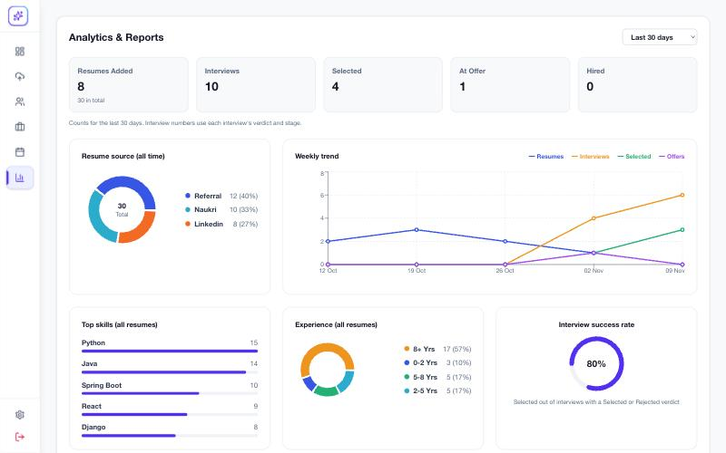 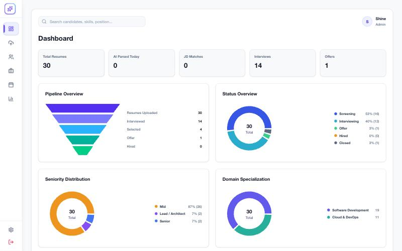 |

## Phase 4 · Polish

### 13. In-app messages instead of browser popups

All `alert()` / `confirm()` calls replaced by a shared toast and confirm dialog.

| Before | After |
| --- | --- |
| _No visual before (see text)_ | 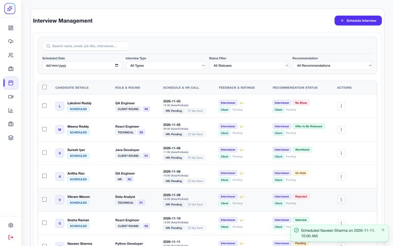 |

### 14. Sidebar down to 7 items

Dashboard, Upload, Candidates, JD Match, Interviews, Analytics, Settings. Resume templates open from Candidates; interview types live in Settings.

| Before | After |
| --- | --- |
| 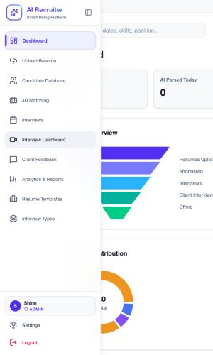 |  |

### 15. Phone layout

Bottom navigation bar and interview cards instead of a side rail and a 1,150 px table.

| Before | After |
| --- | --- |
| 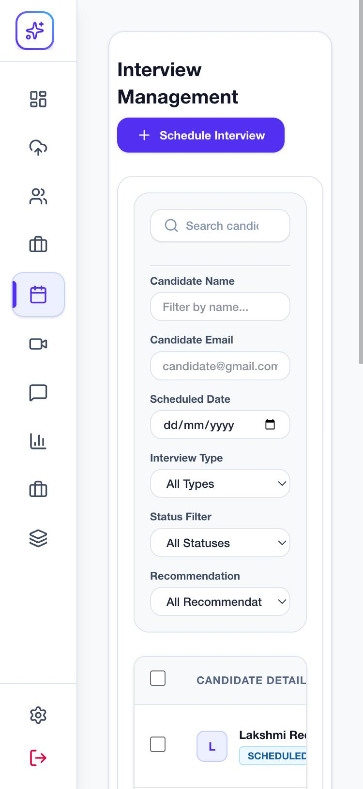 | 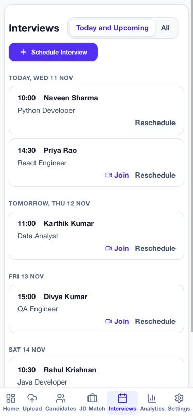 |

## Testing
- `tsc` clean; production build succeeds.
- Backend: 134 passed, including new `test_route_auth.py` and `test_hiring_stage.py`. The 1 failure + 5 errors also fail before these changes (test setup).
- Checked in the browser against a local database with seeded interviews. Not clicked through: the in-app delete confirmation and the transcription fix.

## Notes for reviewers
- Callers without a login token now get 401 on the routes above. Nothing in this repo calls them without one.
- Settings needs login but not admin; restricting writes to admins is a sensible follow-up.
- This landed on `development` without review; comments on this PR are the place to flag anything.
